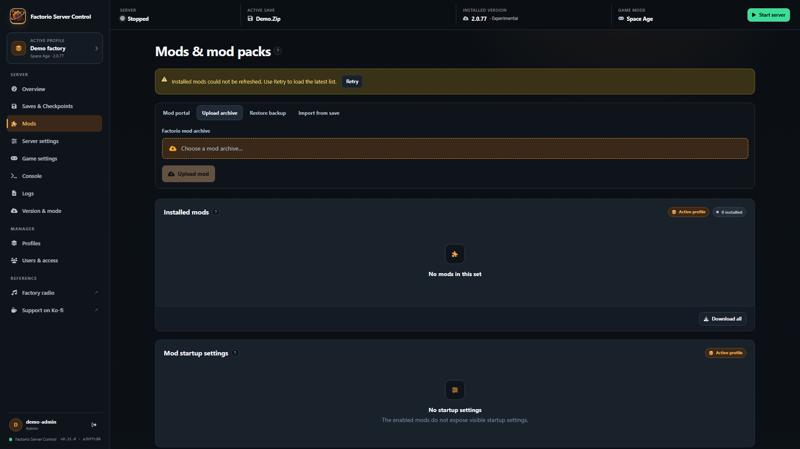

# Maintainability and failure-path review — 2026-10-28

## Scope and baseline

This review starts at `main` commit `dbdfdf8`, application version **0.20.2**. It covers the repository's Go runtime/API/bootstrap/storage, React routes/shared clients, isolated Lua exporters, tests, deployment/build/release boundaries and contributor documentation. Work is source-only on a focused branch: no live game installation, private save, production credentials, release tag, registry image or deployment is changed.

Review combines responsibility/call-path inspection, three independent focused reviews, failure injection, compiler/vet/static analysis, dependency reachability scanning and synthetic browser tests. It is not a proof of perfect software or an assertion that every line, third-party mod and possible concurrent schedule has been exhaustively verified.

## Responsibilities instead of large mixed files

The largest original production file had **1,562 lines**. The reviewed layout has **200 imperative production files**, with the largest at **468 lines** when measured before this report. The source-budget validator computes current counts rather than relying on these historical numbers.

| Original concentration | Focused ownership after cleanup |
| --- | --- |
| `factorio/map_snapshot.go` — 1,562 lines | Settings/scheduling, DTOs, exporter workspace, bounded rendering and snapshot-store activation |
| `factorio/profiles.go` — 1,168 lines | Manifest, profile management, capture, activation/rollback and mounted-directory transactions |
| `api/handlers.go` — 1,119 lines | Shared transport helpers and separate save, runtime, settings and user handlers |
| `factorio/server.go` — 914 lines | State model, lifecycle admission, initialization/settings, process signals and console/RCON handling |
| `factorio/checkpoints.go` — 829 lines | Domain operations, state store, archive IO, retention and monitoring |
| `api/routes.go` — 745 lines | Router/middleware/authorization, general route catalog and mod route catalog |
| Other mixed modules | Separate release installation/file transactions, startup-setting revisions/value validation, dependency planning/version constraints, world settings and backup validation |

Extractions retain the existing package boundaries, route order and one-playable-process model. They are not unrelated microservices or a new persistence framework. `scripts/validate-source-layout.py` rejects production imperative files above **500 physical lines**, including newly added non-ignored source. Tests, generated files, dependencies, assets, CSS and declarative workflows are outside that budget. A size ceiling cannot detect every god object: cohesion, ownership and lock contracts still require review. Compressing code or adding grandfather exceptions is not an acceptable way to pass it.

## Confirmed defects and regression coverage

| Failure | Correction and evidence |
| --- | --- |
| Two release/game-mode API paths bypassed the shared JSON body limit | Use the existing bounded helper. Oversized-body regressions reject with 413 before the operation. |
| `null` server-settings JSON could cause a nil-map panic on profile reload, or be committed as a broken configuration; invalid admin-list roots were accepted during reload | Validate one non-null settings object and an array of administrator names before publishing, reject null HTTP input with 400 and keep old runtime/files on failure. A second JSON root is rejected. `server_config_test.go` and `settings_validation_test.go`. |
| Force-stop dereferenced an unpublished or absent child process | Idempotent stopped behavior, explicit unpublished-process error and lifecycle-protected process selection. `server_force_stop_test.go`. |
| Windows console API failures terminated the entire manager through `log.Fatalf` | Return errors, preserve retryable state and restore the process-wide console handler on failure. Injected Windows regressions cover signaling and restoration errors. |
| Release replacement could overlap a start admitted after the middleware's stopped check | Claim the shared engine-operation reservation while lifecycle admission is held, then release the lifecycle mutex before network IO. Starts receive a conflict rather than waiting behind the download. Barrier/transport regressions in `release_lifecycle_test.go` failed before the fix. |
| Release cleanup deleted the recovery backup when rollback itself failed | Preserve and report the backup on incomplete rollback; refuse subsequent replacement until retained recovery state is reconciled. Injected rename/rollback regressions in `release_files_recovery_test.go` prove original bytes survive. |
| Legacy LevelDB migration ignored failed inserts and deleted the only original data | Validate records, commit one SQLite transaction, return failures, retain LevelDB and prove an already migrated account before retrying. Include non-default and rotated-default credential retries. `bootstrap/migration_test.go`. No password/hash values in migration SQL logs. |
| File-lock normalization could terminate the process; blocking helpers could retry an unrecoverable error forever | Return resolver errors, retry only actual contention and handle acquisition failures before mutation. Injected-resolver and contention regressions in `lockfile_test.go`. |
| Legacy mod-pack conversion exposed partially written destinations and removed the entire original directory | Sibling staging, bounded flat ZIP validation, no-overwrite source tracking and retained `.zip.migrated` archives. Incomplete/ambiguous states fail with an explicit recovery path. Startup preparation/initialization errors now exit nonzero. Malformed, restart, collision, suffix-name and subprocess tests cover these paths. |
| Oversized log lines permanently stopped process-pipe draining and made log reads fail | Bound each record, drain oversized content without retaining it, record an omission marker and continue with later lines. Ordered WebSocket publication removes the goroutine-per-log-line path; remove the empty duplicate error-log hook. Stream/tail regressions prove later lines remain readable. |
| Invalid map chunk coordinates were multiplied before validation | Check range before tile conversion. Snapshot-coordinate regression failed before the fix. |
| Interrupted map activation could discard the last recovery snapshot or hide rollback failure | Recover a retained previous snapshot before activation, reject invalid recovery entries, preserve failed rollback evidence and report cleanup separately from commit. Injected-rename regression in `map_snapshot_test.go`. |
| Structured API error objects could crash global notifications or individual error panels | One safe plain-text message helper, shared toast/client boundaries and affected route error states; never render nested/private objects or mutate structured response contracts. Renderer/helper regressions. |
| Stale checkpoint reads could overwrite a newer mutation or load | Request generations and invalidation around mutations; deferred-response tests. |
| A reset remained enabled while startup settings were being saved | Disable the reset with the rest of the form; pending-save renderer test. |
| Console input was lost after a failed socket send | Clear only after local send acceptance; retain the non-replayable command contract. Socket/console tests. |
| A completed mutation followed by a failed read appeared to be a failed mutation | Separate commit feedback from refresh feedback across runtime/profile/release/mod flows. Show stale-data warnings/Retry and prevent writes based on a stale mod list while retaining the active form/tab. Renderer tests cover the distinct paths. |
| Save-mod import could notify after its component unmounted | Cancel ownership of the late UI response without pretending the server-side operation was cancelled. Unmount regression. |

Behavior fixes were led by regressions or explicit injected failure cases. Pure file moves/import ordering and removal of unused helpers do not invent a new user feature. Staticcheck also removed dead authentication/version/exporter helpers, invalid ignored JSON tag options and redundant code. Cleanup-only errors retain ordinary Go error-string conventions.

## Compatibility and human development

HTTP paths/methods, administrator/viewer boundaries, technical module/image/executable names, `FSM_*` settings, data roots, profile schemas and mount layouts remain stable. No feature is removed merely to reduce file size. A refused corrupt/ambiguous legacy migration now stops startup rather than silently exposing incomplete data.

The legacy Go helper result tuples now put `error` last. External **Go source** users of `ReadModPackRequest`, `ModPortalList`, `ModPortalModDetails` or `FactorioLogin` must adjust their assignments when rebuilding. These are not HTTP response changes; existing deployed binaries/containers and stored data are unaffected by that source-level refactor.

The maintained handoff is [DEVELOPMENT.md](DEVELOPMENT.md), [ARCHITECTURE.md](ARCHITECTURE.md), [API.md](API.md), [OPERATIONS.md](OPERATIONS.md), [CONTRIBUTING.md](../CONTRIBUTING.md) and [RELEASE.md](../RELEASE.md). Together they cover isolation, configuration precedence, code ownership, lock relationships, API/WebSocket contracts, persistence/schema compatibility, debugging, change recipes, tests, recovery and opt-in publication.

## Verification and honest limits

Local Windows checks use Node 24 and the exact Go **1.26.10** toolchain. Completed before PR handoff:

- `npm ci`: **0 reported advisories** at the time of the check.
- Go short suite across all six packages, coverage, `go vet` and pinned Staticcheck.
- **75 UI unit/renderer tests** and production build; **70 production-bundle browser checks** across desktop Chromium/Firefox/WebKit and mobile Chromium/WebKit viewports.
- Python repository-validator tests, Unraid metadata validation, source budget and whitespace checks.
- Govulncheck: **zero reachable symbol/package findings**. Its module-only advisory `GO-2026-5932` concerns unmaintained `golang.org/x/crypto/openpgp`, which this application does not import; the module is required for bcrypt. No upstream fix is available for that intentionally deprecated package. This is not a claim of zero module advisories.

Measured short-suite statement coverage before final handoff: main **44.4%**, API **33.8%**, WebSocket **33.3%**, bootstrap **67.5%**, Factorio **59.1%**, lockfile **91.5%**. Coverage is deliberately reported rather than described as complete. Engine/network/platform-dependent branches still require the separate integration checks; superficial tests solely to inflate a percentage are not a substitute.

CI additionally runs the complete Linux short suite with the race detector, Windows tests, the browser matrix, production-container build, mounted-directory transactions and two disposable real-engine lifecycle scenarios. The pull request must pass that matrix before merge. Local Windows has no configured C compiler, so Linux race/mount checks are not claimed as local results.

Remaining verification boundaries: authenticated Mod Portal downloads require a disposable authorized account; arbitrary mod combinations, every Factorio release, production load/soak testing, physical mobile devices, actual OBS use, full disaster restore and all possible process/filesystem failures are not exhaustively covered. Intentional fail-closed cryptographic/bootstrap failures and programmer-only invalid-constant assertions are not converted into fake successful operations. Future changes still require targeted review/tests.

## Synthetic UI evidence

The 16:9 capture below uses only the disposable browser fixture. It shows a committed mod upload whose subsequent list refresh failed: the upload tab stays open, writes are disabled while data is stale, and Retry can restore them without replaying the upload. It contains no private saves, account data or live server state.

